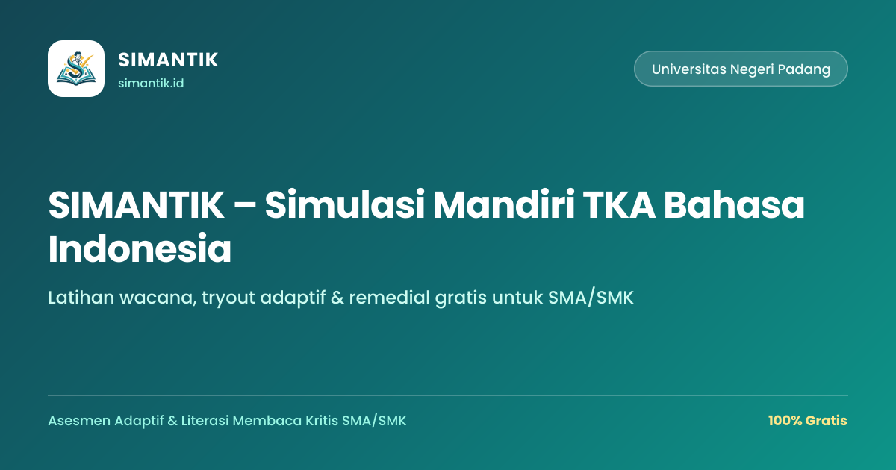
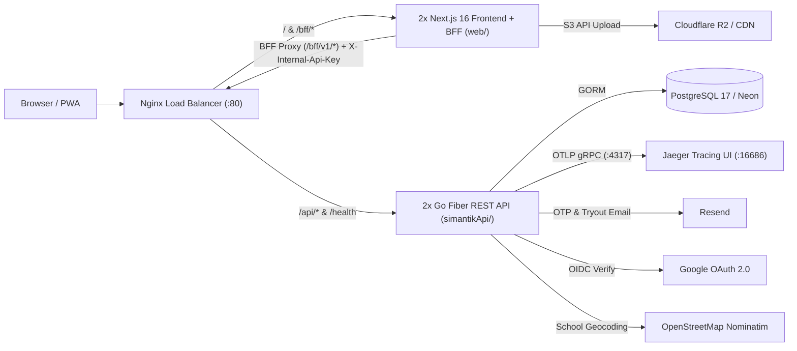

<div align="center">
  

  <h1>SIMANTIK</h1>

  <p>
    <strong>Simulasi Mandiri Tes Kemampuan Akademik</strong><br />
    Platform Pembelajaran Berbasis Wacana &amp; Asesmen Adaptif Bahasa Indonesia
  </p>

  <p>
    Dikembangkan oleh <strong>Tim Ahli Bahasa &amp; Komputer Universitas Negeri Padang (UNP)</strong><br />
    <a href="https://simantik.id">Website Resmi</a> &bull;
    <a href="https://simantik.id/documentation">Dokumentasi</a> &bull;
    <a href="https://simantik.id/news">Berita</a> &bull;
    <a href="./AGENTS.md">Panduan Developer (AGENTS.md)</a>
  </p>

  <p>
    <a href="https://go.dev/"></a>
    <a href="https://gofiber.io/"></a>
    <a href="https://nextjs.org/"></a>
    <a href="https://react.dev/"></a>
    <a href="https://bun.sh/"></a>
    <a href="https://www.postgresql.org/"></a>
    <a href="https://opentelemetry.io/"></a>
  </p>

  <br />

  
</div>

---

## Daftar Isi

- [Tentang SIMANTIK](#tentang-simantik)
- [Ringkasan Fitur](#ringkasan-fitur)
  - [1. Autentikasi, RBAC, & Pemilihan Sekolah](#1-autentikasi-rbac--pemilihan-sekolah)
  - [2. Pengalaman Belajar Siswa](#2-pengalaman-belajar-siswa)
  - [3. Panel Content Manager & Admin](#3-panel-content-manager--admin)
  - [4. Halaman Publik, PWA, SEO, & Infrastruktur Produksi](#4-halaman-publik-pwa-seo--infrastruktur-produksi)
- [Arsitektur Sistem](#arsitektur-sistem)
- [Tech Stack](#tech-stack)
- [Struktur Direktori](#struktur-direktori)
- [Ringkasan Domain Data (40 Model GORM)](#ringkasan-domain-data-40-model-gorm)
- [Ringkasan Endpoint API](#ringkasan-endpoint-api)
- [Instalasi & Menjalankan](#instalasi--menjalankan)
- [Variabel Lingkungan](#variabel-lingkungan)
- [Pengujian, Linting, & CI/CD](#pengujian-linting--cicd)

---

## Tentang SIMANTIK

**SIMANTIK (Simulasi Mandiri Tes Kemampuan Akademik)** adalah platform pembelajaran berbasis wacana dan asesmen adaptif Bahasa Indonesia (mendukung jenjang **SD**, **SMP**, **SMA**, dan **SMK** dengan fokus utama literasi TKA & SNBT/UTBK berbasis *Higher Order Thinking Skills / HOTS*).

Platform ini dirancang dalam **4 siklus pembelajaran terpadu**:

1. **Belajar Mandiri Berbasis Wacana**: Mempelajari modul dan materi bacaan lintas genre yang dipetakan ke kompetensi TKA (Pemahaman Tekstual, Pemahaman Inferensial, Evaluasi & Apresiasi, serta Kosakata Kontekstual).
2. **Asesmen Mandiri & Tryout Adaptif**: Mengerjakan paket latihan terarah dan simulasi tryout berbatas waktu dengan **Adaptive Difficulty Engine** (skala kesulitan 1–5) serta pengawasan ujian (*proctoring*) di browser.
3. **Analisis Diagnostik Kelemahan**: Mesin umpan balik berbasis data (*Feedback Engine*) menghitung skor penguasaan, *gap score* berbobot kesulitan, distraktor dominan, waktu respons, dan tren performa per kompetensi.
4. **Rekomendasi Materi Remedial**: Menyarankan materi bacaan dan latihan lanjutan secara otomatis untuk menutup celah penguasaan yang terdeteksi.

Repositori ini menggunakan arsitektur **polyglot monorepo** yang menggabungkan REST API berbasis **Go 1.25 + Fiber v2 + GORM** (`simantikApi/`) dan aplikasi web berbasis **Next.js 16 App Router + React 19 + Bun** (`web/`), lengkap dengan **Nginx Load Balancer**, **OpenTelemetry + Jaeger**, dan **Cloudflare R2**.

---

## Ringkasan Fitur

### 1. Autentikasi, RBAC, & Pemilihan Sekolah

- **Role-Based Access Control (RBAC)**: Mendukung 3 peran utama (`student`, `content_manager`, `admin`) dengan model `Role`, `Permission`, dan `RolePermission`.
- **Alur Autentikasi Lengkap**:
  - Registrasi akun baru dengan verifikasi **kode OTP via Resend Email** (termasuk *resend OTP*).
  - Login menggunakan kredensial maupun **Google OAuth 2.0 / OIDC** (`/auth/loginGoogle`).
  - Lupa kata sandi dan atur ulang kata sandi berbasis verifikasi OTP (`/forgot-password`, `/verify-otp`, `/reset-password`).
  - **JWT Access Token** berumur pendek (default 15 menit) + **Refresh Token** (default 7 hari) dalam *httpOnly cookie*, proteksi *rate limiting* (`AuthLimiter`), serta gerbang rahasia internal `X-API-SECRET` / `X-Internal-Api-Key`.
- **Pemilihan & Pengajuan Sekolah Berbasis Peta (`/pilih-sekolah`, `/pilih-sekolah/ajukan`)**:
  - Pencarian master data sekolah (NPSN, jenjang SD/SMP/SMA/SMK, negeri/swasta, provinsi/kabupaten/kecamatan) yang telah diverifikasi.
  - Pencarian alamat & *reverse geocoding* terintegrasi **OpenStreetMap Nominatim** (`GeoService` dengan *in-memory TTL cache* 15 menit & *rate limiter*) serta **Leaflet Map Picker** (`SchoolMapPicker`).
  - Siswa dapat mengajukan sekolah baru yang belum terdaftar, memantau status pengajuan (`pending`/`verified`/`rejected`), lalu diverifikasi oleh admin.

### 2. Pengalaman Belajar Siswa

- **Dashboard Siswa (`/student/dashboard`)**:
  - Ringkasan progres belajar, pencapaian, tren performa terbaru, akses cepat materi belajar, dan daftar berita/pengumuman.
- **Pembelajaran Berbasis Wacana (`/student/learning`)**:
  - Daftar modul & materi terfilter sesuai jenjang siswa, detail materi lengkap dengan tujuan pembelajaran, struktur konten, lampiran (`MaterialAttachment`), serta pencatatan progres baca (`LearningProgress`).
  - Halaman **Rekomendasi Remedial (`/student/learning/rekomendasi`)** berisi saran materi dan kompetensi prioritas yang dihasilkan sistem (dapat dibuat ulang atau di-*dismiss*).
- **Latihan Terarah (`/student/practice`)**:
  - Paket latihan per kompetensi/jenjang dengan dukungan **3 tipe soal**: Pilihan Ganda Tunggal (`multiple_choice`), Pilihan Ganda Kompleks (`complex_multiple_choice` / MCMA), dan Benar/Salah atau Matriks (`true_false`).
  - Pengatur waktu, penyimpanan jawaban *idempotent*, *auto-submit* otomatis, serta halaman hasil (`/student/practice/[id]/result`) lengkap dengan palet nomor soal, pembahasan (`explanation`), dan strategi menjawab (`answeringTips`).
- **Tryout Adaptif & Proctoring (`/student/tryout`)**:
  - **Isolated Adaptive Difficulty Engine (`simantikApi/internal/domain/adaptive/engine.go`)**: Menyesuaikan tingkat kesulitan soal secara dinamis pada rentang **level 1–5** menggunakan *dynamic streak window* (1–3 soal) dan *tie-breaker* (`LEVEL_UP`, `LEVEL_DOWN`, `STAY`, `TIE_BREAKER`), memilih kandidat soal tanpa pengulangan, serta mencatat jalur adaptif lengkap di `AttemptQuestion`.
  - **Browser Proctoring (`ProctoringProvider`)**: Pengawasan sesi ujian otomatis yang mendeteksi 8 jenis pelanggaran (`TAB_SWITCH`, `WINDOW_BLUR`, `EXIT_FULLSCREEN`, `COPY_ATTEMPT`, `PASTE_ATTEMPT`, `CUT_ATTEMPT`, `RIGHT_CLICK`, `DEVTOOLS_SHORTCUT`) dengan *deduplication window* dan *auto-submit* ketika batas pelanggaran tercapai.
  - **Laporan Hasil Tryout via Email**: Pengiriman ringkasan hasil dan review butir soal berbasis wacana (`single`, `mcma`, `matrix`) ke email peserta melalui Resend.
- **Evaluasi Diagnostik & Feedback Engine (`/student/evaluation`)**:
  - **Data-Driven Feedback Engine (`feedback_engine.go`)**: Menganalisis bukti jawaban dari tryout & latihan untuk menghitung akurasi, *gap score* berbobot tingkat kesulitan, rata-rata waktu respons jawaban salah, distraktor yang paling sering dipilih, tren historis (`improving`, `stable`, `declining`), serta pengelompokan level penguasaan (`low` < 40, `medium` 40–69, `high` ≥ 70).
  - Rapor siswa (`/api/v1/reports/student`) dan review detail tiap percobaan (`/api/v1/attempts/:attemptId/review`).
- **Notifikasi, Testimoni, Berita, & Profil**:
  - Notifikasi *in-app* dengan penghitung pesan belum dibaca dan tandai baca satuan/semua.
  - Prompt pengiriman **Testimoni Siswa** (dengan mekanisme *snooze* & proteksi duplikasi).
  - Portal berita siswa (`/student/news`), manajemen profil & sekolah (`/student/profile`), ubah kata sandi & avatar, serta pengaturan preferensi bahasa (`i18next`) di `/student/setting`.

### 3. Panel Content Manager & Admin

Baik `content_manager` (`/content_manager/*`) maupun `admin` (`/admin/*`) memiliki ruang kerja khusus berbasis peran:

- **Dashboard & Analitik Reporting**:
  - Dashboard KPI dengan visualisasi grafik **Recharts** untuk admin (`/admin/dashboard`) dan content manager (`/content_manager/dashboard`).
  - Endpoint analitik mendalam: ringkasan keseluruhan sistem, analitik per paket tryout, analisis butir soal (*question item analysis*), pemetaan penguasaan kompetensi, dan distribusi tingkat kesulitan.
- **Manajemen Bank Soal, Stimulus Wacana, & Kompetensi**:
  - CRUD kompetensi (pembuatan kode otomatis & *reuse* kode) dan referensi tipe soal.
  - **Stimulus / Wacana Bersama (`/stimuli`)**: Pengelolaan teks bacaan bersama yang dapat ditautkan (*link/unlink*) ke banyak butir soal sekaligus, dilengkapi fitur *backfill* khusus admin.
  - CRUD soal satuan maupun **bulk** dengan **Rich Text Editor (`eddyter`)**, pengaturan level kesulitan 1–5, opsi jawaban fleksibel, pembahasan, tips menjawab, dan status publikasi (`draft`/`published`).
- **Manajemen Modul, Paket Latihan, & Paket Tryout**:
  - CRUD modul & materi (dengan *cascading publish*, ekspor silabus, dan tabel inspeksi aktivitas siswa per materi).
  - CRUD paket latihan & tryout lengkap dengan penjadwalan (`startAt`/`endAt`), durasi, target jenjang, sinkronisasi bank soal (`sync`), serta halaman inspeksi hasil & detail jawaban setiap siswa.
- **CMS Konten Publik**:
  - Pengelolaan penuh **Berita** (`/news`), **Dokumentasi/Panduan** (`/docs` dengan kategori), **Video Tutorial** (`/tutorials` dengan embed YouTube & durasi), serta moderasi status **Testimoni** (`/testimonials`).
- **Administrasi Sistem (Khusus Admin)**:
  - **Manajemen Pengguna**: Daftar & detail siswa (`/admin/students`) serta content manager (`/admin/content-managers`), perubahan status akun, pengaturan peran, serta riwayat aktivitas & progres belajar.
  - **Manajemen & Moderasi Sekolah (`/admin/schools`)**: CRUD master data sekolah berbasis peta, serta aksi verifikasi (`verify`) atau penolakan (`reject`) dengan catatan alasan untuk sekolah yang diajukan pengguna.
  - **Broadcast Notifikasi & System Info**: Pengiriman notifikasi massal ke pengguna (`/api/v1/admin/notifications/broadcast`), pemeriksaan informasi sistem (`/api/v1/system/info`), dan pencatatan `AuditLog`.

### 4. Halaman Publik, PWA, SEO, & Infrastruktur Produksi

- **Portal Publik & SEO**:
  - Halaman publik lengkap: `/home`, `/documentation` (+ `[slug]`), `/news` (+ `[slug]`), `/tutorials`, `/testimonials`, `/help`, `/privacy`, `/terms`.
  - SEO modern: OpenGraph dinamis (`og-card`), `sitemap`, verifikasi Search Console (Google & Bing), serta **`/llms.txt`** dan **`/llms-full.txt`** untuk visibilitas mesin pencari & AI.
- **PWA & Instalasi Cepat**:
  - Konfigurasi `manifest.webmanifest` lengkap dengan ikon *any* & *maskable*, *app shortcuts*, hook `usePWAInstall`/`usePWAUpdate`, serta QR Code pemasangan (`qrcode.react`).
- **Object Storage (Cloudflare R2)**:
  - Unggah aset media & lampiran langsung ke **Cloudflare R2** menggunakan `@aws-sdk/client-s3` yang disajikan melalui domain CDN (`R2_URL`).
- **High-Availability & Observability**:
  - **Nginx Load Balancer (`./nginx/nginx.conf`)**: Algoritma `least_conn` dengan *health check* otomatis ke 2 instance API (`api-1`, `api-2`) dan 2 instance Web (`web-1`, `web-2`), kompresi Gzip, dan header diagnostik `X-Served-By`.
  - **Distributed Tracing**: Instrumentasi **OpenTelemetry** pada Fiber (`otelfiber`) dan GORM (`gorm/opentelemetry`) yang mengirim trace OTLP gRPC ke **Jaeger** (`http://localhost:16686`).
  - **SafeMigrator (`simantikApi/cmd/migrate/main.go`)**: CLI migrasi skema aman dengan mode `-inspect` / `-dry-run` (deteksi penambahan kolom, potensi *rename*, kolom tak terpetakan) dan *safety guard* wajib `-confirm-production` pada lingkungan produksi.

---

## Arsitektur Sistem

Permintaan dari browser melewati **Nginx Load Balancer** menuju instance **Next.js Frontend (`web/`)** atau langsung ke instance **Go Fiber API (`simantikApi/`)**. Untuk panggilan API dari sisi browser, frontend menggunakan **BFF Proxy (`/bff/[...path]`)** yang menyisipkan `NEXT_INTERNAL_API_SECRET` secara *server-side* agar kredensial internal tidak pernah terekspos ke klien.



---

## Tech Stack

| Lapisan | Teknologi Utama |
| --- | --- |
| **Backend (`simantikApi/`)** | Go 1.25, Fiber v2, GORM + `pgx` (PostgreSQL / Neon), `go-playground/validator/v10`, JWT (`golang-jwt/jwt/v5`), `bcrypt`, `golang.org/x/time/rate`, Resend Email API, OpenStreetMap Nominatim, Air (live reload) |
| **Frontend (`web/`)** | Next.js 16 (App Router), React 19, TypeScript, Bun, Tailwind CSS v4, Radix UI / shadcn/ui, TanStack React Query, Redux Toolkit (+ `redux-persist`), React Hook Form + Zod, Recharts, Leaflet & React-Leaflet, Eddyter (Rich Text Editor), Framer Motion, GSAP, Lenis, `i18next`, `qrcode.react`, `@aws-sdk/client-s3` (Cloudflare R2) |
| **Infrastruktur & Observabilitas** | Docker & Docker Compose, Nginx (`alpine`, load balancer), PostgreSQL 17 (`alpine`) / Neon Serverless, OpenTelemetry (`otelfiber` & `gorm/opentelemetry`), Jaeger All-in-One |
| **Kualitas Kode & CI/CD** | `go test -race`, `go vet`, `golangci-lint`, `bun test`, Biome (lint & format), GitHub Actions ([`ci.yml`](./.github/workflows/ci.yml) & [`graphify.yml`](./.github/workflows/graphify.yml)) |

---

## Struktur Direktori

```text
Simantik/
├── .github/workflows/
│   ├── ci.yml                      # CI otomatis (Go tests -race, Biome check, Bun test, Next.js build)
│   └── graphify.yml                # Pembaruan otomatis knowledge graph repositori
├── AGENTS.md                       # Konvensi kode & panduan cepat developer
├── docker-compose.yml              # Orkestrasi penuh: Nginx + 2x API + 2x Web + Jaeger + PostgreSQL
├── .env.example                    # Templat variabel lingkungan root (Docker / VPS)
├── nginx/
│   └── nginx.conf                  # Konfigurasi reverse proxy & load balancer (least_conn)
├── simantikApi/                    # Backend REST API (Go 1.25 + Fiber v2 + GORM)
│   ├── Dockerfile                  # Multi-stage Docker build backend
│   ├── .env.example                # Templat variabel lingkungan backend
│   ├── cmd/
│   │   ├── api/main.go             # Entry point API, DI wiring, OpenTelemetry, graceful shutdown
│   │   └── migrate/main.go         # CLI SafeMigrator (-inspect / -dry-run / -confirm-production)
│   ├── config/                     # Env loader, koneksi DB (Neon-tuned pool), & SeedInitialData
│   ├── internal/
│   │   ├── database/               # SafeMigrator & inspeksi skema
│   │   ├── domain/adaptive/        # Isolated Adaptive Difficulty Engine (pure domain, tanpa HTTP/DB)
│   │   ├── dto/                    # Struct request/response + validator tags
│   │   ├── handler/                # Fiber HTTP handlers (menggunakan response envelope)
│   │   ├── middleware/             # API Secret, JWT Auth, Optional JWT, RBAC, Rate Limiter, Security
│   │   ├── models/                 # 40 entitas GORM (diurutkan di migrate.go)
│   │   ├── repository/             # Interface & implementasi GORM per domain
│   │   ├── routes/                 # Registrasi 16 kelompok rute /api/v1/*
│   │   └── service/                # Logika bisnis, Feedback Engine, Geo Service, Tryout Email
│   ├── pkg/                        # Utilitas response envelope, JWT, telemetry tracer, dll.
│   └── tests/                      # Unit test service, middleware, utils, & route role matrix (in-memory mocks)
└── web/                            # Frontend Web App & BFF Proxy (Next.js 16 + Bun)
    ├── Dockerfile                  # Container image frontend
    ├── .env.example                # Templat variabel lingkungan frontend
    ├── public/                     # Aset statis, logo, favicon, manifest PWA, llms.txt & llms-full.txt
    └── src/
        ├── api/                    # HTTP client & server-fetch wrapper
        ├── app/
        │   ├── (auth)/             # Login, Register, Verify OTP, Forgot & Reset Password
        │   ├── (docs)/             # Pilih Sekolah & Ajukan Sekolah (/pilih-sekolah/*)
        │   ├── (public)/           # Home, Documentation, News, Tutorials, Testimonials, Help, Privacy, Terms
        │   ├── (private)/          # Ruang kerja student/*, content_manager/*, dan admin/*
        │   ├── bff/[...path]/      # BFF Proxy same-origin menuju backend (inject internal API secret)
        │   └── api/session/        # Manajemen cookie sesi server-side
        ├── components/             # Atomic Design (atoms, molecules, organisms, templates, page, pwa)
        ├── configs/                # Env validation (@t3-oss/env-nextjs), query keys, endpoints, site & theme
        ├── core/                   # Layouts & Providers (termasuk ProctoringProvider)
        ├── hooks/                  # Custom hooks (useProctoring, useApi, usePWAInstall, useService/*)
        ├── schemas/                # Skema validasi Zod (auth, school, dll.)
        ├── services/               # Layanan panggilan API per domain
        └── types/                  # Definisi tipe model, service, UI, dan form
```

---

## Ringkasan Domain Data (40 Model GORM)

Seluruh entitas didaftarkan secara berurutan sesuai dependensi *foreign key* pada [`./simantikApi/internal/models/migrate.go`](./simantikApi/internal/models/migrate.go):

| Klaster Domain | Entitas Model |
| --- | --- |
| **Auth & RBAC** | `Role`, `Permission`, `RolePermission`, `User`, `RefreshToken`, `OTPCode`, `PasswordResetToken`, `ExternalAccount` |
| **Sekolah & Profil** | `School`, `StudentProfile` |
| **Pembelajaran** | `Competency`, `FileRecord`, `LearningModule`, `Material`, `MaterialAttachment`, `LearningProgress` |
| **Bank Soal & Wacana** | `QuestionType`, `Stimulus`, `Question`, `QuestionOption`, `QuestionCompetency`, `QuestionExplanation` |
| **Tryout Adaptif** | `Tryout`, `TryoutQuestion`, `TryoutAttempt`, `AttemptQuestion`, `StudentAnswer` |
| **Latihan Terarah** | `PracticePackage`, `PracticePackageQuestion`, `Practice`, `PracticeAnswer` |
| **Evaluasi & Remedial** | `Evaluation`, `CompetencyEvaluation`, `Recommendation` |
| **CMS Publik** | `News`, `Documentation`, `Tutorial`, `Testimonial` |
| **Sistem & Notifikasi** | `AuditLog`, `Notification` |

> **Baseline Seeding (`config/seed.go`)**: Saat `DB_AUTO_MIGRATE=true` pada lingkungan development, sistem secara *idempotent* mengisi data awal berupa 3 peran (`student`, `admin`, `content_manager`), 3 tipe soal (`multiple_choice`, `complex_multiple_choice`, `true_false`), dan 3 kompetensi dasar (`TEKSTUAL`, `INFERENSIAL`, `EVALUASI`).

---

## Ringkasan Endpoint API

Seluruh rute di bawah `/api/v1` memerlukan header **`X-API-SECRET`** (atau **`X-Internal-Api-Key`** dari BFF proxy) dan mengembalikan *response envelope* seragam (`{ success, message, data, error }`). Endpoint `GET /health` bersifat publik untuk *load balancer* dan Docker *health check*.

| Kelompok Rute | Prefix Utama | Akses | Ringkasan Fitur |
| --- | --- | --- | --- |
| **Health & System** | `/health`, `/api/v1/health`, `/api/v1/system/info` | Publik / Admin | Health check service & informasi sistem |
| **Auth** | `/api/v1/auth/*` | Publik (Rate Limited) | Register, verifikasi/kirim ulang OTP, login, Google OAuth, refresh token, logout, lupa & reset password |
| **Users** | `/api/v1/users/*` | Auth / Admin | Profil sendiri (`me`, update profil/password/avatar/sekolah/roles), manajemen user admin |
| **Schools** | `/api/v1/schools/*`, `/api/v1/admin/schools/*` | Publik / Auth / Admin | Daftar sekolah publik, pengajuan sekolah oleh siswa, CRUD & verifikasi/penolakan sekolah oleh admin |
| **Geo** | `/api/v1/geo/*` | Auth | Pencarian lokasi sekolah & *reverse geocoding* via OpenStreetMap Nominatim |
| **Learning** | `/api/v1/learning-modules/*`, `/api/v1/materials/*`, `/api/v1/learning-progress` | Auth / CM / Admin | CRUD modul & materi, status publikasi, progres baca siswa, inspeksi aktivitas siswa |
| **Questions & Competencies** | `/api/v1/competencies/*`, `/api/v1/question-types`, `/api/v1/questions/*` | Auth / CM / Admin | CRUD kompetensi, tipe soal, serta CRUD soal satuan & *bulk* |
| **Stimuli** | `/api/v1/stimuli/*`, `/api/v1/admin/stimuli/backfill` | CM / Admin | CRUD wacana/stimulus bersama, *link/unlink* soal, dan *backfill* stimulus |
| **Practice** | `/api/v1/practice-packages/*`, `/api/v1/practices/*`, `/api/v1/practice-attempts/*` | Auth / CM / Admin | CRUD paket latihan, mulai & kerjakan latihan, submit/auto-submit, hasil & analitik siswa |
| **Tryouts & Attempts** | `/api/v1/tryouts/*`, `/api/v1/attempts/*` | Auth / CM / Admin | CRUD tryout & sinkronisasi soal, mulai attempt (manual/auto), soal adaptif per nomor, submit jawaban, complete/auto-submit |
| **Evaluations** | `/api/v1/evaluations/*`, `/api/v1/attempts/:attemptId/{evaluation,review}` | Auth | Profil kompetensi siswa, daftar & detail evaluasi, evaluasi & review detail per attempt |
| **Recommendations** | `/api/v1/recommendations/*` | Auth | Generate rekomendasi remedial otomatis, daftar rekomendasi, dan *dismiss* |
| **Reporting & Analytics** | `/api/v1/reports/student`, `/api/v1/admin/reports/*` | Auth / CM / Admin | Rapor siswa, dashboard overview, analitik tryout, analisis butir soal, kompetensi, & tingkat kesulitan |
| **CMS Content** | `/api/v1/cms/*`, `/api/v1/{news,documentation,tutorials,testimonials}/*` | Publik / Auth / CM / Admin | CRUD & publikasi berita, dokumentasi, video tutorial, serta pengajuan & moderasi testimoni |
| **Notifications** | `/api/v1/notifications/*`, `/api/v1/admin/notifications/broadcast` | Auth / Admin | Daftar notifikasi, *unread count*, tandai baca, dan *broadcast* notifikasi massal |
| **Admin Operations** | `/api/v1/admin/*` | Admin | Dashboard admin, manajemen user, aktivitas & progres pengguna, ubah status & role |

---

## Instalasi & Menjalankan

### Prasyarat

- **Go 1.25+** (dan opsional [Air](https://github.com/air-verse/air) untuk *live reload* backend)
- **[Bun](https://bun.sh/)** (runtime & package manager wajib untuk frontend — jangan gunakan npm/yarn/pnpm)
- **Docker & Docker Compose** (untuk menjalankan seluruh stack atau database PostgreSQL lokal)
- Layanan eksternal (opsional saat dev, wajib untuk fitur penuh): **PostgreSQL / Neon**, **Google OAuth**, **Resend**, dan **Cloudflare R2**

### Opsi A — Menjalankan Full Stack via Docker Compose

Menjalankan **Nginx Load Balancer** (`:80`), **2x API Go** (`:8080`), **2x Web Next.js** (`:3000`), **Jaeger Tracing UI** (`:16686`), dan **PostgreSQL 17** (`5433` host → `5432` container) sesuai [`./docker-compose.yml`](./docker-compose.yml):

```bash
git clone git@github.com:MuliaAndiki/Simantik.git
cd Simantik

# Salin dan lengkapi seluruh berkas environment
cp .env.example .env
cp simantikApi/.env.example simantikApi/.env
cp web/.env.example web/.env

# Jalankan seluruh layanan
docker compose up --build
```

Setelah seluruh container berstatus *healthy*:
- **Aplikasi Web (via Nginx)**: `http://localhost`
- **Health Check Load Balancer / API**: `http://localhost/lb-health` dan `http://localhost/health`
- **Jaeger Tracing UI**: `http://localhost:16686`

### Opsi B — Pengembangan Lokal Terpisah

#### 1. Backend (`simantikApi/`)

```bash
cd simantikApi
cp .env.example .env
# Konfigurasikan DATABASE_URL (Neon) atau DB_HOST/DB_PORT/DB_USER/DB_PASSWORD/DB_NAME lokal

go mod download

# (Opsional) Inspeksi skema database dengan SafeMigrator tanpa mengubah tabel
go run ./cmd/migrate -inspect

# Jalankan server development (port default 8080)
air
# atau tanpa Air:
go run ./cmd/api
```

#### 2. Frontend (`web/`)

Buka terminal baru dari root repositori:

```bash
cd web
cp .env.example .env.local
# Pastikan NEXT_INTERNAL_API_SECRET sama dengan API_SECRET di backend

bun install
bun run dev
```

Frontend berjalan di `http://localhost:3000` dan meneruskan permintaan browser melalui BFF proxy (`/bff/v1/*`) ke `BACKEND_URL` (`http://localhost:8080`).

---

## Variabel Lingkungan

Gunakan templat resmi di [`./.env.example`](./.env.example), [`./simantikApi/.env.example`](./simantikApi/.env.example), dan [`./web/.env.example`](./web/.env.example). Jangan pernah melakukan *commit* berkas `.env` ke repositori.

> **Penting**: Nilai `NEXT_INTERNAL_API_SECRET` di frontend **harus sama** dengan `API_SECRET` di backend. Jangan pernah memberi prefix `NEXT_PUBLIC_` pada variabel server-only (`BACKEND_URL`, `R2_URL`, `NEXT_INTERNAL_API_SECRET`, maupun kredensial R2).

### Root / Docker (`.env`)

| Variabel | Keterangan |
| --- | --- |
| `NGINX_PORT` | Port publik untuk Nginx Load Balancer (default `80`) |
| `NEXT_PUBLIC_APP_URL`, `BACKEND_URL`, `R2_URL` | URL publik aplikasi, URL upstream backend (server-only), dan URL CDN Cloudflare R2 |
| `OTEL_ENABLED`, `OTEL_SERVICE_NAME`, `OTEL_EXPORTER_OTLP_ENDPOINT`, `OTEL_INSECURE` | Konfigurasi pengiriman trace OpenTelemetry ke Jaeger (`jaeger:4317`) |
| `DB_USER`, `DB_PASSWORD`, `DB_NAME` | Kredensial container PostgreSQL lokal |

### Backend (`simantikApi/.env`)

| Kelompok | Variabel | Keterangan |
| --- | --- | --- |
| **Aplikasi & Gate** | `APP_ENV`, `APP_PORT`, `API_SECRET` | Mode lingkungan, port API (default `8080`), dan shared secret header `X-API-SECRET` |
| **JWT & Cookie** | `JWT_SECRET`, `JWT_ACCESS_EXPIRY_MINUTES`, `REFRESH_EXPIRY_DAYS`, `COOKIE_SECURE`, `COOKIE_SAMESITE` | Penandatanganan token akses (15m), refresh token (7d), dan konfigurasi cookie |
| **Google OAuth** | `GOOGLE_CLIENT_ID`, `GOOGLE_CLIENT_SECRET`, `GOOGLE_REDIRECT_URL` | Kredensial Google OAuth / OIDC |
| **Email (Resend)** | `RESEND_API_KEY`, `RESEND_FROM_EMAIL` | Pengiriman OTP & laporan hasil tryout (fallback ke *dev logger* bila kosong) |
| **Database** | `DATABASE_URL` atau `DB_HOST`, `DB_PORT`, `DB_USER`, `DB_PASSWORD`, `DB_NAME`, `DB_SSLMODE`, `DB_MAX_OPEN_CONNS`, `DB_MAX_IDLE_CONNS`, `DB_AUTO_MIGRATE`, `DB_AUTO_MIGRATE_FORCE`, `DB_LOG_LEVEL` | Koneksi PostgreSQL / Neon (gunakan `DB_AUTO_MIGRATE=false` di produksi) |
| **Tracing** | `OTEL_ENABLED`, `OTEL_SERVICE_NAME`, `OTEL_EXPORTER_OTLP_ENDPOINT`, `OTEL_INSECURE` | Konfigurasi OpenTelemetry OTLP gRPC |

### Frontend (`web/.env.local`)

| Cakupan | Variabel | Keterangan |
| --- | --- | --- |
| **Server-Only** | `NODE_ENV`, `AUTH_SECRET_KEY`, `NEXT_INTERNAL_API_SECRET`, `BACKEND_URL`, `R2_URL` | Rahasia sesi, shared secret BFF, upstream backend, dan base URL CDN |
| **Cloudflare R2** | `NEXT_CLOUDFLARE_ACCOUNT_ID`, `NEXT_ACCESS_KEY_ID`, `NEXT_SECRET_ACCESS_KEY` | Kredensial unggah objek ke Cloudflare R2 |
| **Public (`NEXT_PUBLIC_*`)** | `NEXT_PUBLIC_APP_URL`, `NEXT_PUBLIC_BASEPATH`, `NEXT_PUBLIC_GOOGLE_CLIENT_ID`, `NEXT_PUBLIC_GOOGLE_SITE_VERIFICATION`, `NEXT_PUBLIC_BING_SITE_VERIFICATION` | URL publik, basepath awal (`/home`), Google Client ID, dan verifikasi SEO |
| **Build / CI** | `SKIP_ENV_VALIDATION` | Lewati validasi `@t3-oss/env-nextjs` saat build CI (`true`/`false`) |

---

## Pengujian, Linting, & CI/CD

### Backend (`simantikApi/`)

Unit test backend menggunakan *in-memory mock repositories* sehingga dapat dijalankan dengan cepat tanpa database aktif:

```bash
cd simantikApi
go test -v -race ./...          # Menjalankan seluruh unit & route role matrix tests dengan race detector
go vet ./...                    # Analisis statis standar Go
golangci-lint run ./...         # Linting & pemeriksaan kualitas kode (auto-fix: --fix)
```

### Frontend (`web/`)

```bash
cd web
bun run check                   # Biome format & lint check (auto-fix: bun run check:write)
bun test                        # Menjalankan seluruh unit test Bun
SKIP_ENV_VALIDATION=true bun run build  # Verifikasi production build Next.js
```

### GitHub Actions

- **[`./.github/workflows/ci.yml`](./.github/workflows/ci.yml)**: Berjalan otomatis pada `push` dan `pull_request` ke cabang `main`, `master`, dan `develop` — menjalankan `backend-test` (`go test -v -race ./...`) dan `frontend-test` (`bun run check`, `bun test`, serta `bun run build`).
- **[`./.github/workflows/graphify.yml`](./.github/workflows/graphify.yml)**: Menjaga keterbaruan peta arsitektur kode (`graphify-out/`).
